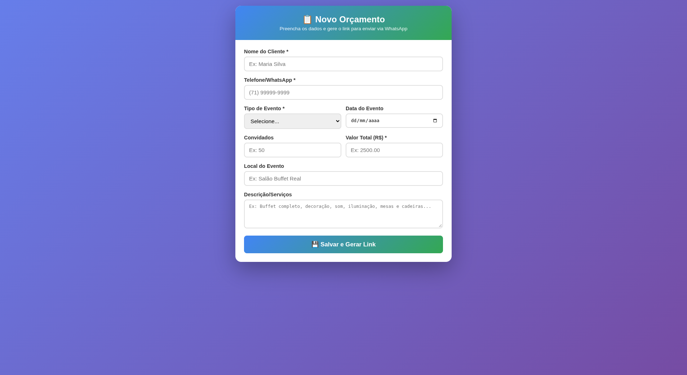
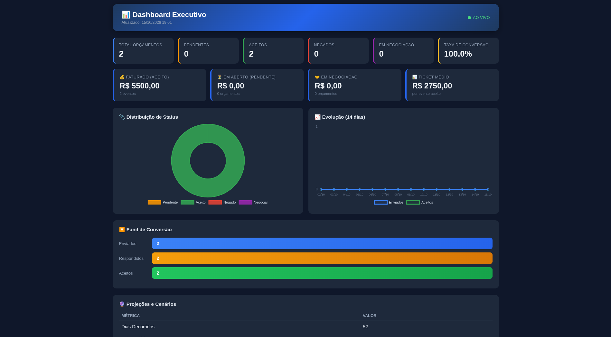

 WhatsApp Quote System 

> Zero-cost SaaS for quote management via WhatsApp — built for micro-businesses
> that still run on paper. Serverless, mobile-first, production-ready.

The Problem

Millions of micro-entrepreneurs — caterers, photographers, event planners,
home bakers — send quotes via WhatsApp and track responses **on paper notebooks**.
When the notebook is lost, the business loses revenue and credibility.

The Solution

A complete quote lifecycle system with **zero infrastructure cost**:

- Business form — register quotes in seconds, generate a WhatsApp-ready
  message with a unique response link
- Client response page — mobile-first, one-tap Accept / Negotiate / Decline,
  double-response prevention
- Executive BI dashboard — live KPIs, conversion funnel, 14-day trend charts,
  financial projections (pessimistic / realistic / optimistic), auto-refresh every 30s
- Event agenda — upcoming confirmed events with 7/30-day visual alerts
- Google Sheets database — validated schema, locale-safe server-side
  calculations, native charts

Architecture

┌─────────────┐ WhatsApp ┌──────────────┐ │ Business │──────────────────▶│ Client │ │ Form │ message + link │ (mobile) │ └──────┬──────┘ └──────┬───────┘ │ google.script.run │ response ▼ ▼ ┌─────────────────────────────────────────────────┐ │ Google Apps Script (server-side) │ │ doGet routing · CRUD · metrics · dashboard │ └────────────────────┬────────────────────────────┘ │ ▼ ┌─────────────────────────────────────────────────┐ │ Google Sheets (database + dashboard) │ └─────────────────────────────────────────────────┘

Key decisions:
- Serverless by design — Google Apps Script eliminates hosting costs entirely
- No WhatsApp API — response links avoid API fees and compliance overhead
- Server-side calculations — dashboard metrics computed in JavaScript, not
  spreadsheet formulas, to avoid locale (comma vs. dot) corruption
- Chart.js via CDN — rich BI without build tooling

Screenshots

| Client Page | Executive BI |
|:---:|:---:|
|  |  |

Quick Start

1. Create a Google Sheet → **Extensions → Apps Script**
2. Copy files from `src/` into the project (1 `.gs` + 3 `.html`)
3. Run `setupSheet()` (authorize on first run)
4. Deploy → Web app → Anyone** → copy the `/exec` URL
5. Paste the URL into `WEB_APP_URL` → run `setupSheet()` again → redeploy

Full guide: [setup/INSTALL.md](setup/INSTALL.md)

Business Model

Designed as a multi-tenant SaaS from day one:

| Plan | Price/mo | Quotes | Target |
|---|---|---|---|
| Free | $0 | 10 | Trial / informal sellers |
| Basic | R$ 39 | 50 | Solo entrepreneurs |
| Pro | R$ 79 | 200 | Small businesses |
| Premium | R$ 149 | Unlimited | Agencies / clinics |
| White Label | R$ 299 | Unlimited | Resellers |

Validated across 10 market segments (food service, events, photography,
healthcare, beauty, construction) with per-segment ROI analysis.
Details: [docs/business-model.md](docs/business-model.md)

Engineering Lessons Learned

Documented pitfalls solved during development ([full list](docs/lessons-learned.md)):

- Locale-safe number formatting (`setNumberFormat` after `clearFormat`)
- Chart builder `slices` config at creation time — never `modify()`/`updateChart()`
- Header-free ranges for pie charts to prevent slice color shifting
- Column-count validation in `setValues()` to avoid range mismatch exceptions

Tech Stack

`JavaScript` · `Google Apps Script` · `HTML5/CSS3` · `Chart.js 4.4` ·
`Google Sheets API` · `Serverless` · `Mobile-first UX`

License

[MIT](LICENSE)

---

Built in Salvador, Brazil — solving real problems for real small businesses.
